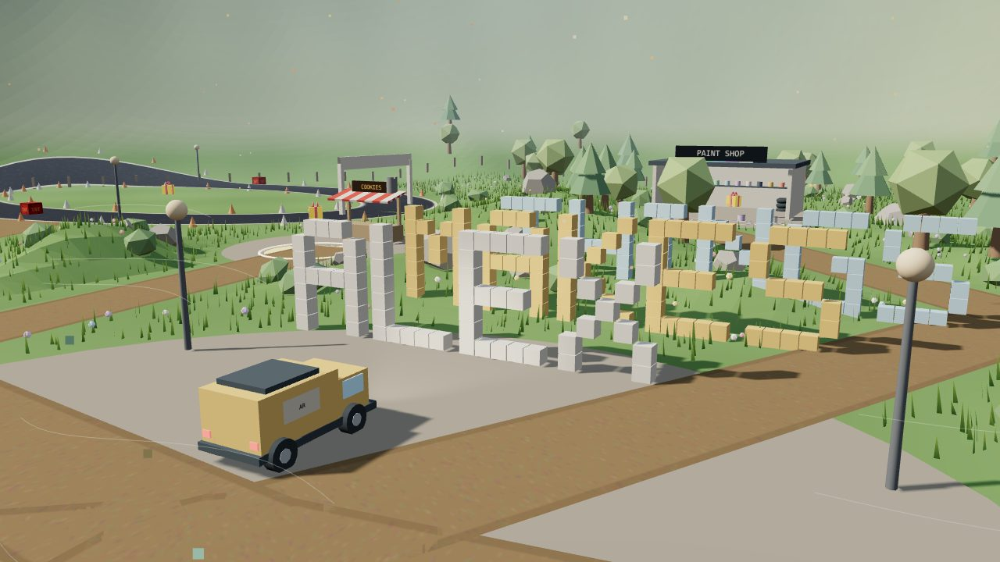

# The Yard

A 3D portfolio you drive around. It's the home of the browser games by **Tiny Pixel Works**.

**▶ Play: https://goat99zyx.github.io/the-yard/**

Drive a parcel van around a low-poly island and park on a glowing pad to open each game. Along the way you can knock over the letters, race the circuit, jump from the jetty to the lake island, repaint the van, find 12 gold parcels and get chased by the dog.

**Controls:** WASD to drive · Shift to boost · Space to jump · W/S in the air to flip · H to honk · N for day/night · T for weather · P for photo mode · M for music. Phones get an on-screen stick.

## Want one for your own portfolio?

The template version, where you edit one config file with your name, projects, links and timeline, is on itch.io: **https://goat99zyx.itch.io/the-yard-portfolio-template**

Custom builds (your own buildings, layout or vehicle): zyx888goat@outlook.com

Built with Three.js r128 (MIT) and AI assistance (Claude).
